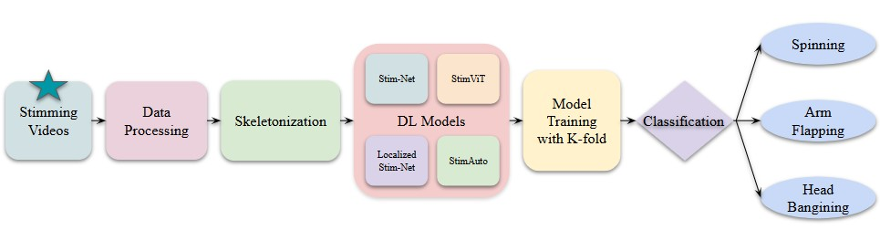
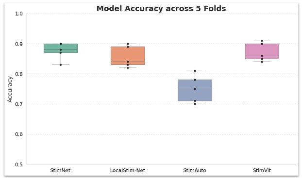

# AI Vision to Care: A QuadView of Deep Learning for Detecting Harmful Stimming in Autism

## 🧠 Abstract

Children with Autism Spectrum Disorder (ASD) often exhibit repetitive movements known as *stimming*, such as arm flapping or head banging. While some behaviors are harmless, others like head banging can cause physical harm and require timely intervention. This project proposes a deep learning-based system to classify stimming behaviors using **skeletal data extracted from videos**, offering a robust and better alternative to raw video analysis.

We introduce a multi-model framework — *StimNet*, *Local StimNet*, *StimAuto*, and *StimViT* — built on CNNs, Autoencoders, and Vision Transformers, achieving up to **87.77% accuracy** in multi-class stimming classification across real-world, unstructured video data.

---

## 🔄 Workflow Overview



### 🗃️ 1. Dataset Collection and Cleaning
- Based on SSBD + extended videos (ASDB).
- Manual annotation and segmenting of clips.
- Quality filtering reduced dataset to 92 high-quality subjects.

### 🧍 2. Skeletal Data Extraction
- Used MediaPipe Holistic to extract 33 keypoint 3D skeletons from each frame.
- Skeletal sequences stored as NumPy arrays for training.

### 🧹 3. Preprocessing and Augmentation
- Smoothing, normalization to 72 frames.
- Augmented dataset (×3 to ×15 per subject) for better generalization.

### 🧠 4. Model Architectures

| Model         | Key Idea                                | Deep Learning Type         |
|---------------|------------------------------------------|----------------------------|
| **StimNet**   | Pose Differentiation (slow/fast motion) | 1D CNN                     |
| **Local StimNet** | Region-wise motion tracking           | Multi-Stream 1D CNN        |
| **StimAuto**  | Feature encoding from raw skeleton       | Autoencoder + MLP          |
| **StimViT**   | Temporal-spatial attention on poses      | Vision Transformer         |

---

## 📈 Results

| Model         | Accuracy | F1 Score | AUC     |
|---------------|----------|----------|---------|
| **StimNet**   | **87.77%** | 87.69%   | 90.95%  |
| StimViT       | 87.48%   | 87.48%   | 90.41%  |
| Local StimNet | 85.85%   | 85.85%   | 89.51%  |
| StimAuto      | 75.28%   | 73.96%   | 76.43%  |

 

- StimNet and StimViT consistently outperformed other models.
- Confusion matrices and ROC plots across folds show robustness across classes.

---

## 🧩 Repository Structure

```bash
.
├── data/                        # Preprocessed skeleton data (.pkl/.npy)
├── models/                     # Model architectures: CNN, AE, ViT
│   ├── stimnet.ipynb
│   ├── local_stimnet.ipynb
│   ├── stimauto.ipynb
│   └── stimvit.ipynb
├── images/                     # Figures from thesis (for README.md) 
├── requirements.txt
└── README.md
